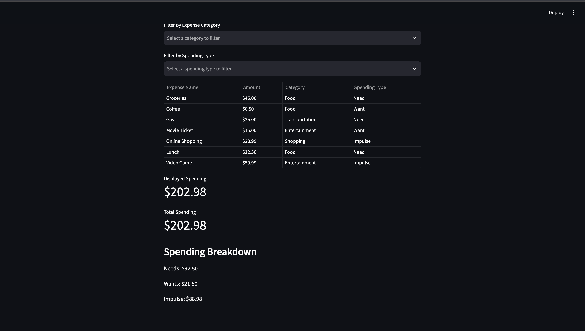

# Personal Expense Tracker

A simple expense tracking application built with Python and Streamlit to help users track their spending habits.

## Features

- Add expenses with a name, amount, and category
- Label purchases as Need, Want, or Impulse
- View recorded expenses
- Calculate total spending
- View spending totals by purchase type
- Select from categories such as Groceries, Food & Drinks, Transportation, Shopping, Entertainment, Bills, Health, and Other
- Filter expenses by category and spending type
- View expenses in a table with formatted dollar amounts
- Load sample expenses from a CSV file
- Display warning messages when required information is missing
- Automatically save expenses to a CSV file
- Load previously saved expenses when restarting the application

## Technologies

- Python
- Streamlit
- Git and GitHub
- CSV

## How to Run

1. Install the required packages:

   python3 -m pip install -r requirements.txt

2. Start the application:

   python3 -m streamlit run app.py

3. Open the local URL displayed in the terminal.

## How It Works

Users can enter an expense name, amount, category, and purchase type.

The application checks that all required fields are completed before adding the expense.

Expenses are displayed in a table. The application calculates total spending and separates purchases into Need, Want, and Impulse.

Users can filter their expenses by category or spending type. If no filters are selected, all recorded expenses are displayed.

When an expense is added, the application automatically saves it to `expenses.csv`.

When the application starts a new session, it loads previously saved expenses from `expenses.csv`. This allows users to keep their expense records after closing and restarting the application.

The Load Sample Data button reads expenses from `sample_expenses.csv` using `csv.DictReader`. Loading sample data replaces the current expenses and saves the sample records to `expenses.csv`.

## Demo Path

1. Open the Streamlit application.
2. Click "Load Sample Data" to display example expenses.
3. View the expenses, total spending, and Need / Want / Impulse breakdown.
4. Filter expenses by category and spending type.
5. Add a new expense, then restart the application to demonstrate that the expense was saved.

## Sample Data

The repository includes `sample_expenses.csv` with example expenses for testing and demonstration.

The sample data can be loaded into the application by clicking the "Load Sample Data" button.

Loading the sample data replaces the current expenses to prevent duplicate entries.

The application saves loaded sample expenses to `expenses.csv`.

## Known Limitations

1. The application uses local CSV storage instead of a database, making it unsuitable for multiple users accessing and updating expenses at the same time.

2. Users cannot edit or delete individual expenses directly from the application.

3. The application provides basic spending summaries but does not include advanced reports or spending trends over time.

## Current Status

The basic expense-entry and spending-summary features are implemented.

improvements include expense filtering, additional spending categories, improved currency formatting, input validation, sample data loading, and permanent local CSV storage.

Expenses are now automatically saved to `expenses.csv` and loaded when the application starts a new session.

### Architecture

User
  |
  v
app.py (Streamlit Interface)
  |
  v
expense_tracker.py (Expense Calculations and CSV Functions)
  |
  v
expenses.csv (Saved Expense Records)

## Demo Screenshot


## Quickstart
Clone the repository, install the dependencies, and run the application.
```bash
git clone https://github.com/jeromebaisa/Expense-Tracker.git
cd Expense-Tracker && python3 -m pip install -r requirements.txt
python3 -m streamlit run app.py

## Live Demo
Try the Personal Expense Tracker here:
(https://expense-trackergit-knslkf8fhhjwtvlouvqn4v.streamlit.app/)

## Author
Jerome Baisa
GitHub: https://github.com/jeromebaisa